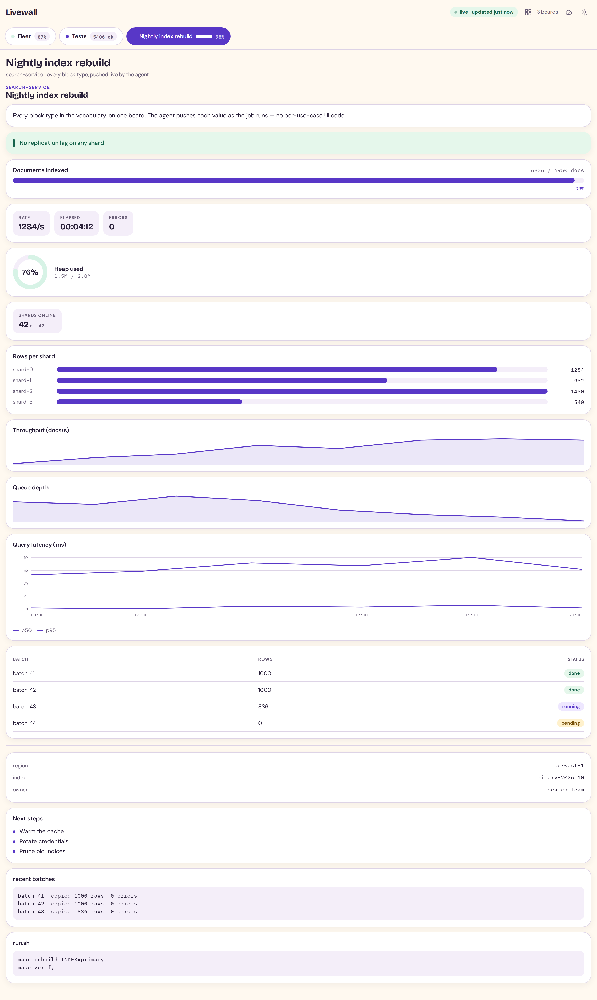
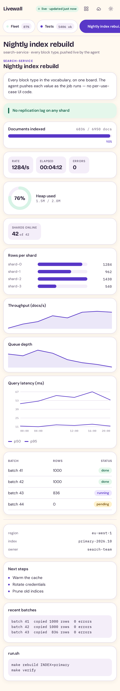

# Livewall

[](https://github.com/ashuio/livewall/actions/workflows/ci.yml)

**Livewall is a live status board your AI agent writes while it works.**

An agent running a long job has two bad options: go silent, or spam you with
status messages. Livewall is the third. The agent sends a small JSON **board
spec** and a browser renders it live. That spec might be a progress bar for a
migration, a table of test results, a log tail, a fleet status wall. None of it
needs per-use-case UI code.

<picture>
  <source media="(prefers-color-scheme: dark)" srcset="docs/screenshot-dark.png">
  
</picture>

*Every block type on one board — light and dark, desktop and phone. The images
are generated by [`scripts/make_screenshot.py`](scripts/make_screenshot.py), so
they cannot drift from what the client actually renders.*

<details>
<summary>On a phone</summary>

<picture>
  <source media="(prefers-color-scheme: dark)" srcset="docs/screenshot-mobile-dark.png">
  
</picture>

</details>

## Why you'd want it

- **Watch the job instead of asking about it.** The agent programs the board
  once and updates it as it works, so the numbers on screen come from the agent,
  not from you scraping logs.
- **No dashboard to build or maintain.** The board is whatever the agent
  describes in a small JSON document; there is no per-use-case frontend.
- **Many jobs, many tabs.** Each agent or session owns a named board, and the
  client shows them as tabs.
- **Boards are ephemeral by design.** A board is a one-off surface for one
  running operation. It lives on a TTL, then it is gone. That is the point:
  there is no state to migrate, back up or clean up between runs.

## How it works

```
   your agent
       │   MCP tool calls: set_board / update_block / update_board / …
       ▼
  mcp/server.py ───────────────► backend/app.py
  (agent-facing tools)           (boards, TTL,
                                  SSE broadcast)
                                        │
                                        │  SSE  (GET /api/stream)
                                        ▼
                              browser (React: renders blocks)
```

1. The agent calls an MCP tool with a **board spec**: title, status, blocks,
   optional tab and TTL. (The bundled **CLI** drives the same API from a shell,
   for callers that are not an MCP host.)
2. The backend stores the board and validates the spec against a shared contract.
3. Every connected browser gets a full snapshot over **SSE**; the React client
   renders the selected board's blocks live.

See [`docs/architecture.md`](docs/architecture.md) for why it is shaped this way.

## Quick start

```bash
git clone https://github.com/ashuio/livewall livewall && cd livewall
cp .env.example .env          # optional: every value has a working default
docker compose up --build     # http://127.0.0.1:8470
```

That builds the client, starts the backend, and serves both on one origin.

<details>
<summary>Running without Docker</summary>

```bash
make install                  # .venv (backend + MCP + test deps) + web/node_modules
make build                    # client -> web/dist
make backend                  # http://127.0.0.1:8470
```

`make install` builds ONE virtualenv at `.venv/` holding every dependency the
backend, the MCP server and the test suites need; `make test` uses it.

For client development, run Vite alongside the backend. It proxies `/api`:

```bash
cd web && npm run dev         # http://127.0.0.1:5183
```
</details>

## Guides

New to Livewall? These walk the whole path:

- [Getting started](docs/getting-started.md): from nothing to a board you can
  watch update, over Docker or bare metal, then wired to an agent.
- [Cookbook](docs/cookbook.md): copy-paste recipes — a migration, test results, a
  log tail, a fleet wall, a CI step, a metric over time.
- [Pushers](docs/pushers.md): boards that update **themselves** — poll an endpoint,
  a command or a file and push on an interval, with no agent attached.
- [Troubleshooting](docs/troubleshooting.md): the failure modes a new user hits,
  and the fix for each.
- [Examples](examples/README.md): small runnable scripts you can copy.

The full reference set is indexed in [`docs/README.md`](docs/README.md).

## Wiring it to an agent

Add the MCP server to your client. Most MCP clients — Claude Desktop, Cursor,
Claude Code (`.mcp.json`), and others — read a `mcpServers` JSON object:

```json
{
  "mcpServers": {
    "livewall": {
      "command": "/path/to/livewall/.venv/bin/python",
      "args": ["/path/to/livewall/mcp/server.py"],
      "env": { "LIVEWALL_URL": "http://127.0.0.1:8470" }
    }
  }
}
```

Use the interpreter that has `fastmcp` and `httpx` — the one `make install`
builds at `.venv/bin/python`. If your host uses a different config shape, adapt
the same command and args; some hosts read a YAML `mcp_servers` map instead:

```yaml
mcp_servers:
  livewall:
    command: /path/to/livewall/.venv/bin/python
    args: ['/path/to/livewall/mcp/server.py']
```

The agent then gets **11 tools** (`set_board`, `update_block`,
`describe_blocks`, and so on) and can program a board mid-task.
`describe_blocks` is how it learns the vocabulary at runtime. See
[`docs/mcp.md`](docs/mcp.md) for every tool, or
[`mcp/README.md`](mcp/README.md) for a shorter reference.

### Teach your agent the workflow

Tools tell an agent *what it can call*; they do not tell it *when to reach for
Livewall* or which traps cost a cycle. [`skills/livewall/`](skills/livewall/SKILL.md)
is an [Agent Skill](https://agentskills.io) — a small `SKILL.md` an agent loads
when the task fits, covering when to use a board, the workflow shape, and the
mistakes that are easy to make (a running board is pruned after an hour of
silence, an existing id is a 409, `list` items are scalars, and so on).

Drop the folder where your agent looks for skills, or point it at the file. It
carries no block vocabulary on purpose — that is `describe_blocks`' job, so the
skill cannot drift out of date.

A board spec is small:

```json
{
  "title": "Migration",
  "status": "running",
  "ttl": 1800,
  "tab": {"label": "Migration", "accent": "violet",
          "indicator": {"kind": "bar", "value": 6836, "max": 6950}},
  "blocks": [
    {"id": "p", "type": "progress", "label": "Rows copied",
     "value": 6836, "max": 6950, "unit": "rows"},
    {"id": "c", "type": "callout", "tone": "ok", "text": "No errors so far"},
    {"id": "l", "type": "log", "title": "recent", "lines": ["batch 41 ok"]}
  ]
}
```

Later, update one block without resending the board:

```json
{"id": "p", "set": {"value": 6950}}
```

## Command-line client

An MCP host is not the only way to drive a board. The bundled **CLI** wraps the
same API, so a shell script, a cron job, or a CI step can program one — and you
can see it working in a single command:

```bash
pipx install ./cli            # stdlib only; installs the `livewall` command
livewall demo                 # creates a sample board — open the web client
livewall update livewall-demo --block p --set '{"value": 4}'
livewall watch livewall-demo  # follow it from the terminal
```

`livewall --help` lists every command (`ls`, `get`, `set`, `update`, `reset`,
`rm`, `config`, `watch`, `demo`, `health`). It reads `LIVEWALL_URL` and
`LIVEWALL_TOKEN` from the environment. See [`cli/README.md`](cli/README.md).

## Block types

`heading` · `text` · `stat` · `stats` · `progress` · `gauge` · `bar` ·
`sparkline` · `chart` · `line` · `table` · `log` · `kv` · `list` · `callout` ·
`code` · `divider`

That is **17 block types** rendered through **15 components** (`chart` is
an alias of `sparkline`; `stat`/`stats` share one chip component). The exact
field list of each is in
[`docs/blocks.md`](docs/blocks.md), and call `describe_blocks` over MCP for the
runtime copy.

The charts are interactive: `line` and `sparkline` snap a crosshair to the
nearest point and read out the value there, so a chart shows its numbers without
you eyeballing the axis.

**Numbers are exact by default**: `6836`, not `6.8K`. Compaction is a
deliberate per-value choice. Send a string (`"1.5M"`) for a pre-formatted label,
or `"fmt": "compact"` on a `progress`/`gauge`/`bar` whose ratio still needs a
real number. The full rule is in [`docs/blocks.md`](docs/blocks.md#numbers).

## Layout

```
backend/   FastAPI: boards, SSE, TTL, pruning; streams each board's blocks
web/       React client: renders the blocks, live
mcp/       MCP server: the agent-facing tool surface
cli/       command-line client (stdlib only; `pipx install ./cli`)
skills/    an Agent Skill (SKILL.md) that teaches an agent the workflow
examples/  small runnable scripts that program a board (copy-and-run), plus a pusher
scripts/   the test runner (`make test` boots a throwaway backend)
docs/      the adopter's manual (API, blocks, MCP, deployment, pushers, protocol)
```

## Protocol

The board spec is the wire format: the server streams each board's own `blocks`
exactly as stored, and the client renders them directly. There is no
intermediate UI protocol, so the stream is inspectable and any client that can
render the block vocabulary can draw the board. The wire shape and the render
contract are in [`docs/protocol.md`](docs/protocol.md).

## Configuration

All via environment variables; the MCP server also loads a repo-root `.env`
(see [`.env.example`](.env.example)). Defaults:
loopback bind, port `8470`, finished boards expire after `1800s`, running boards
after `3600s` idle, at most `12` boards. Runtime config changes persist to disk
(`LIVEWALL_CONFIG_FILE`) so a restart does not revert them.

The backend binds **loopback by default**. Setting **`LIVEWALL_TOKEN`** turns on
**bearer-token auth**: every `/api/*` endpoint then requires
`Authorization: Bearer <token>` (or `?token=<token>`), while `/health` and the
static client stay open. Unset, the API is open — the quickstart default. The
backend, the CLI and the MCP server read the token from the process environment
(the MCP server also reads a repo-root `.env`, and `docker compose` substitutes
it from `.env` into the container). The browser client never reads an env var —
it takes the token from `?token=<token>` once and stores it. See
[`docs/deploying.md`](docs/deploying.md).

The client's view is also driven by the URL, and these params compose with
`?token=` (the token is stripped; the others survive):

- **`?board=<id>`** deep-links a board: it is selected and pinned on load, and
  clicking a tab writes the selection back to the address bar so the URL is
  shareable. An unknown id falls back to following the newest board, with a
  quiet notice.
- **`?kiosk=1`** is wall mode: the app-bar actions and the tab bar are hidden
  and the one selected board is enlarged. It still shows the freshness chip,
  which is where staleness is reported. Exit with the **Esc** key or the exit
  button in the top bar; `?kiosk=0` (or no param) is normal mode. Combine as
  `?kiosk=1&board=<id>`.

The layout is responsive across three bands — **phone** (`<=600px`), **tablet**
(`601–1024px`) and **desktop** (`>=1025px`) — verified at 390×844, 820×1180 and
1280×800: no horizontal overflow, the app bar and tab bar stay usable, and the
freshness chip and error alarm remain visible. On the phone band the app bar and
its action group wrap instead of overflowing, and the app-bar buttons and tabs
grow to 42px touch targets. Kiosk is unaffected at every width.

When there are many boards the tab strip is a cramped horizontal scroller. The
**board overview** — the grid button in the app bar, or the **`g`** key — shows
every board at once (title, status, indicator, age and the error alarm) and
selecting one selects it and writes `?board=` as usual; **Esc** closes it. It is
hidden with a single board and in kiosk (`?kiosk=1`): kiosk is a chrome-free
single-board wall, and an overview would both add chrome and let a passer-by
navigate away.

### Keyboard

The wall is fully operable without a mouse, and every control shows a visible
focus ring:

- **Tab / Shift+Tab** move through the app-bar controls and the tab strip.
- **← / →** (or **↑ / ↓**) move between board tabs, **Home / End** jump to the
  first / last tab, and **Enter** or **Space** selects the focused tab.
- **`g`** toggles the board overview. Inside it, the **arrow keys** move between
  board cards, **Enter** selects one, **Esc** closes it, and focus is trapped in
  the overlay and returned to the grid button on close.
- **Esc** exits kiosk (`?kiosk=1`).

All shell animation — the update pulse, the breathing live dot, the blinking
error dot and the pull spinner — is disabled under
`prefers-reduced-motion: reduce`.

## Status / maturity

**Version `0.0.1`** — the first release. See [`CHANGELOG.md`](CHANGELOG.md).
It is a young project. Every push to `main` and every pull request runs the full
test suite plus a client lint and a Docker build in CI
([`.github/workflows/ci.yml`](.github/workflows/ci.yml)).

What it does have:

- A test suite that boots its own throwaway backend and exits non-zero on
  failure (see below). The browser suites assert on rendered text rather than
  screenshots, so a regression in what a board actually says gets caught.
- Writes that validate before they mutate, and refusals that name the offending
  field instead of failing quietly.

It has not been load-tested. It is also not a metrics store: boards live in
memory and are deliberately short-lived.

## Tests

```bash
make test          # builds the client, boots a throwaway backend, runs every suite
```

`make test` needs no running server: `scripts/run_tests.py` boots the backend on
a free port with a temp config file, runs each suite against it, and exits
non-zero if anything fails. Each suite also runs on its own (and boots its own
backend):

```bash
make test-backend   # edge cases, SSE/stream, config persistence, auth, store concurrency, pusher, vocabulary parity
make test-cli       # the command-line client, end to end
make test-mcp       # MCP contract + write lifecycle
make test-web       # Node unit tests, render + transport + accessibility suites
```

The counts below are what a full run prints on a clean checkout:

| Suite | Checks |
|---|---|
| `backend/tests/edge_test.py` | 142 API edge cases (validation, TTL, prune-during-await, hostile field values, numeric magnitude, board-id collision) |
| `backend/tests/stream_test.py` | 22 SSE/concurrency cases (bounded queue, disconnect leak, keepalive, reaper) |
| `backend/tests/config_persist_test.py` | 58 config round-trip and fallback cases |
| `backend/tests/auth_test.py` | 22 auth-gate cases (enforcement in both directions: open, 401, accepted, every method, `/health` liveness-only when unauthenticated, static exempt) |
| `backend/tests/store_concurrency_test.py` | 3 store-concurrency cases (route handlers never mutate the store off the event loop) |
| `backend/tests/pusher_test.py` | 70 checks on `examples/pusher.py`'s value-resolution path, including a run of every board it builds through the backend's own validator (pure functions, no backend needed) |
| `backend/tests/vocab_parity_test.py` | 92 vocabulary-parity checks (the MCP tool descriptions and the client renderer read exactly what `contract.py` declares) |
| `cli/test_cli.py` | 51 CLI end-to-end checks (every command, collision, bad input, token, unreachable backend) |
| `mcp/test_live.py` | 43 MCP contract + lifecycle checks (11 tools) |
| `web/test/*.test.ts` | 67 Node unit tests on a fake clock (transport, number formatting, token resolution, freshness/TTL) |
| `web/scripts/verify_render.py` | 60 rendered strings across all 17 block types, both themes, 16 component classes |
| `web/scripts/verify_transport.py` | 98 browser transport/lifecycle checks |
| `web/scripts/verify_a11y.py` | 46 accessibility checks (roles and names, keyboard operation, focus, contrast, reduced motion, reflow, clipboard) |

Two details worth knowing:

- The browser render suite **asserts on rendered text**, not a screenshot, and
  **fails if a compacted form like `6.8K` appears where an exact count belongs**.
- The transport unit tests run on a **fake clock and a fake byte stream**, so the
  retry loop, the stall watchdog and visibility-resume are deterministic. No
  sleeps decide whether they pass.

## License

Apache License 2.0. See [`LICENSE`](LICENSE).

Apache-2.0 was chosen over MIT for its **explicit patent grant**. Livewall's own
dependencies are all permissive (Apache-2.0 / MIT / BSD).

Copyright 2026 Ashutosh Varma.
